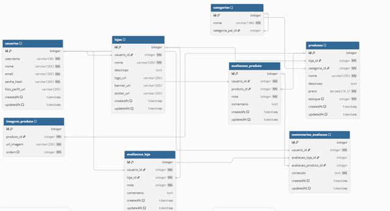
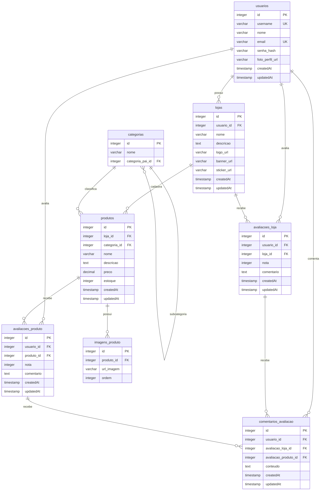

# Modelagem do Banco de Dados Relacional

Especificação técnica do banco de dados relacional para o backend do projeto (Grupo 8 - Processo Trainee CJR 2026.2). A estrutura foi modelada com base no diagrama conceitual fornecido na especificação técnica da atividade.

---

## Diagrama Entidade-Relacionamento

### Diagrama de Referência


### Representação Lógica (Mermaid)



---

## Dicionário de Dados

### 1. usuarios
Armazena as informações de identificação, acesso e perfil dos usuários.

| Campo | Tipo | Restrições | Descrição |
|---|---|---|---|
| id | INTEGER | PK, AUTO_INCREMENT | Identificador primário do registro |
| username | VARCHAR(50) | NOT NULL, UNIQUE | Nome de usuário único na plataforma |
| nome | VARCHAR(255) | NOT NULL | Nome civil ou de exibição |
| email | VARCHAR(255) | NOT NULL, UNIQUE | Endereço de e-mail de acesso |
| senha_hash | VARCHAR(255) | NOT NULL | Hash criptográfico da credencial |
| foto_perfil_url | VARCHAR(255) | NULL | URL da imagem de perfil |
| createdAt | TIMESTAMP | NOT NULL, DEFAULT NOW() | Carimbo de data/hora de criação |
| updatedAt | TIMESTAMP | NOT NULL, DEFAULT NOW() | Carimbo de data/hora da última atualização |

### 2. lojas
Dados das lojas comerciais mantidas pelos usuários da plataforma.

| Campo | Tipo | Restrições | Descrição |
|---|---|---|---|
| id | INTEGER | PK, AUTO_INCREMENT | Identificador primário da loja |
| usuario_id | INTEGER | NOT NULL, FK (usuarios.id) | Chave estrangeira do proprietário da loja |
| nome | VARCHAR(255) | NOT NULL | Nome comercial da loja |
| descricao | TEXT | NULL | Texto de apresentação da loja |
| logo_url | VARCHAR(255) | NULL | URL da logomarca |
| banner_url | VARCHAR(255) | NULL | URL do banner de destaque |
| sticker_url | VARCHAR(255) | NULL | URL do badge ou sticker visual da loja |
| createdAt | TIMESTAMP | NOT NULL, DEFAULT NOW() | Carimbo de criação |
| updatedAt | TIMESTAMP | NOT NULL, DEFAULT NOW() | Carimbo da última atualização |

### 3. categorias
Estrutura hierárquica de categorização de produtos.

| Campo | Tipo | Restrições | Descrição |
|---|---|---|---|
| id | INTEGER | PK, AUTO_INCREMENT | Identificador primário da categoria |
| nome | VARCHAR(100) | NOT NULL | Nome da categoria |
| categoria_pai_id | INTEGER | NULL, FK (categorias.id) | Referência à categoria ancestral (auto-relacionamento) |

### 4. produtos
Catálogo de itens vinculados às lojas e classificados por categoria.

| Campo | Tipo | Restrições | Descrição |
|---|---|---|---|
| id | INTEGER | PK, AUTO_INCREMENT | Identificador primário do produto |
| loja_id | INTEGER | NOT NULL, FK (lojas.id) | Loja ofertante |
| categoria_id | INTEGER | NOT NULL, FK (categorias.id) | Categoria do produto |
| nome | VARCHAR(255) | NOT NULL | Nome do produto |
| descricao | TEXT | NULL | Descrição detalhada das características do item |
| preco | DECIMAL(10,2) | NOT NULL, CHECK (preco >= 0) | Preço unitário em moeda |
| estoque | INTEGER | NOT NULL, DEFAULT 0, CHECK (estoque >= 0) | Saldo de estoque disponível |
| createdAt | TIMESTAMP | NOT NULL, DEFAULT NOW() | Carimbo de criação |
| updatedAt | TIMESTAMP | NOT NULL, DEFAULT NOW() | Carimbo da última atualização |

### 5. imagens_produto
Galeria de mídias de produtos cadastrados.

| Campo | Tipo | Restrições | Descrição |
|---|---|---|---|
| id | INTEGER | PK, AUTO_INCREMENT | Identificador primário da imagem |
| produto_id | INTEGER | NOT NULL, FK (produtos.id) | Produto ao qual a imagem pertence |
| url_imagem | VARCHAR(255) | NOT NULL | URL do recurso no armazenamento |
| ordem | INTEGER | NOT NULL, DEFAULT 1, CHECK (ordem >= 1) | Ordem de exibição no catálogo |

### 6. avaliacoes_produto
Notas e comentários submetidos por usuários a produtos específicos.

| Campo | Tipo | Restrições | Descrição |
|---|---|---|---|
| id | INTEGER | PK, AUTO_INCREMENT | Identificador primário da avaliação |
| usuario_id | INTEGER | NOT NULL, FK (usuarios.id) | Usuário avaliador |
| produto_id | INTEGER | NOT NULL, FK (produtos.id) | Produto avaliado |
| nota | INTEGER | NOT NULL, CHECK (nota BETWEEN 1 AND 5) | Nota quantitativa de 1 a 5 |
| comentario | TEXT | NULL | Texto opinativo opcional |
| createdAt | TIMESTAMP | NOT NULL, DEFAULT NOW() | Carimbo de criação |
| updatedAt | TIMESTAMP | NOT NULL, DEFAULT NOW() | Carimbo da última atualização |

Restrição de unicidade: `UNIQUE (usuario_id, produto_id)` para limitar cada usuário a uma avaliação por produto.

### 7. avaliacoes_loja
Notas e comentários submetidos por usuários sobre a operação e atendimento de uma loja.

| Campo | Tipo | Restrições | Descrição |
|---|---|---|---|
| id | INTEGER | PK, AUTO_INCREMENT | Identificador primário da avaliação |
| usuario_id | INTEGER | NOT NULL, FK (usuarios.id) | Usuário avaliador |
| loja_id | INTEGER | NOT NULL, FK (lojas.id) | Loja avaliada |
| nota | INTEGER | NOT NULL, CHECK (nota BETWEEN 1 AND 5) | Nota quantitativa de 1 a 5 |
| comentario | TEXT | NULL | Texto opinativo opcional |
| createdAt | TIMESTAMP | NOT NULL, DEFAULT NOW() | Carimbo de criação |
| updatedAt | TIMESTAMP | NOT NULL, DEFAULT NOW() | Carimbo da última atualização |

Restrição de unicidade: `UNIQUE (usuario_id, loja_id)` para limitar cada usuário a uma avaliação por loja.

### 8. comentarios_avaliacao
Comentários ou respostas direcionados a avaliações existentes de produtos ou lojas.

| Campo | Tipo | Restrições | Descrição |
|---|---|---|---|
| id | INTEGER | PK, AUTO_INCREMENT | Identificador primário |
| usuario_id | INTEGER | NOT NULL, FK (usuarios.id) | Usuário autor da resposta |
| avaliacao_loja_id | INTEGER | NULL, FK (avaliacoes_loja.id) | Chave estrangeira para avaliação de loja |
| avaliacao_produto_id | INTEGER | NULL, FK (avaliacoes_produto.id) | Chave estrangeira para avaliação de produto |
| conteudo | TEXT | NOT NULL | Texto da resposta |
| createdAt | TIMESTAMP | NOT NULL, DEFAULT NOW() | Carimbo de criação |
| updatedAt | TIMESTAMP | NOT NULL, DEFAULT NOW() | Carimbo da última atualização |

Restrição de integridade: Validação por restrição `CHECK` para garantir exclusividade da chave estrangeira de origem:
```sql
CHECK (
    (avaliacao_loja_id IS NOT NULL AND avaliacao_produto_id IS NULL)
    OR
    (avaliacao_loja_id IS NULL AND avaliacao_produto_id IS NOT NULL)
)
```

---

## Mapeamento de Cardinalidades

- `usuarios` para `lojas`: 1:N (Um usuário pode administrar zero ou várias lojas; cada loja possui exatamente um proprietário).
- `usuarios` para `avaliacoes_produto`: 1:N (Um usuário pode realizar múltiplas avaliações de produtos).
- `usuarios` para `avaliacoes_loja`: 1:N (Um usuário pode realizar múltiplas avaliações de lojas).
- `usuarios` para `comentarios_avaliacao`: 1:N (Um usuário pode interagir em múltiplos comentários).
- `lojas` para `produtos`: 1:N (Uma loja oferta múltiplos produtos).
- `lojas` para `avaliacoes_loja`: 1:N (Uma loja recebe múltiplas avaliações).
- `categorias` para `categorias`: 0..1:N (Auto-relacionamento; categorias podem possuir subcategorias filhas).
- `categorias` para `produtos`: 1:N (Uma categoria abriga múltiplos produtos).
- `produtos` para `imagens_produto`: 1:N (Um produto pode conter múltiplas imagens ordenadas).
- `produtos` para `avaliacoes_produto`: 1:N (Um produto recebe múltiplas avaliações).
- `avaliacoes_loja` para `comentarios_avaliacao`: 0..1:N (Uma avaliação de loja pode receber respostas encadeadas).
- `avaliacoes_produto` para `comentarios_avaliacao`: 0..1:N (Uma avaliação de produto pode receber respostas encadeadas).

---

## Políticas de Integridade Referencial

- `ON DELETE CASCADE`:
  - `lojas.usuario_id`: Ao excluir um usuário, suas lojas associadas são removidas.
  - `produtos.loja_id`: Ao excluir uma loja, todos os seus produtos cadastrados são removidos.
  - `imagens_produto.produto_id`: Ao remover um produto, suas fotos cadastradas são excluídas.
  - `avaliacoes_produto` e `avaliacoes_loja`: Excluídas caso o autor, o produto ou a loja associada sejam removidos.
  - `comentarios_avaliacao`: Excluídos caso a avaliação correspondente ou o usuário sejam removidos.
- `ON DELETE RESTRICT`:
  - `produtos.categoria_id`: Impede a remoção de categorias que possuam produtos atrelados no catálogo.
- `ON DELETE SET NULL`:
  - `categorias.categoria_pai_id`: Caso a categoria ancestral seja excluída, as subcategorias passam ao nível raiz sem perda de dados.

---

## Arquivos Disponíveis

- `database/schema.sql`: Script DDL nativo para PostgreSQL contendo tabelas, chaves primárias, estrangeiras, índices e triggers de atualização.
- `database/schema_mysql.sql`: Script DDL para MySQL/MariaDB.
- `database/schema.dbml`: Definição em DBML para importação direta no dbdiagram.io.
- `prisma/schema.prisma`: Definição de esquema para integração com Prisma ORM.
- `docs/diagrama_orientador.png`: Cópia do diagrama de referência da atividade.
